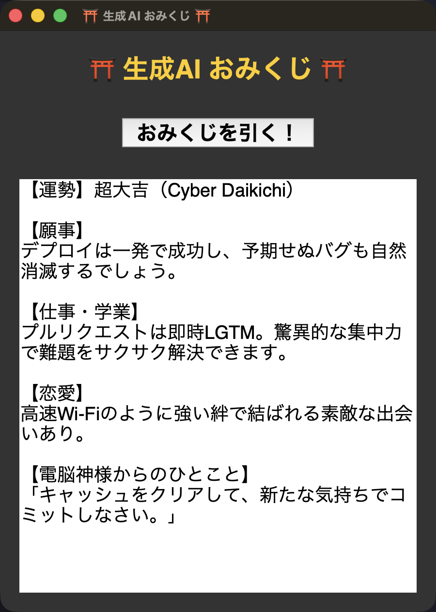

# ⛩️ Omikuji

<p align="center">
  
</p>

<p align="center">
  <b>日本の「おみくじ」を色々な形で実装したリポジトリです。</b><br>
  A collection of different implementations of "omikuji" (Japanese fortune slips).<br>
  Implementações variadas do tradicional "Omikuji" japonês com Python e IA (Gemini).
</p>

<br>

| ファイル / File / Arquivo | 内容 / Description / Descrição |
|---|---|
| `Omikuji.py` | ターミナル版 (オフラインフォールバック対応) / Terminal version / Versão terminal |
| `Omikuji_GUI.py` | Tkinterによる簡易GUI版 / Basic GUI version / Versão básica com Tkinter |
| `Omikuji_AI.py` | **Gemini AI生成GUI版 (.env & オフライン対応)** / **AI-powered GUI version** / **Versão com IA (Gemini)** |

<br>

---

## 🇧🇷 Como Rodar

### Pré-requisitos
- Python 3.9+ (com suporte a Tkinter)
- Chave de API do Gemini gratuita ([Google AI Studio](https://aistudio.google.com/)) *(opcional: se não informada ou se a API falhar, o app ativa o modo de fallback offline automaticamente)*

### Passo a Passo

1. **Clonar o repositório**
   ```bash
   git clone https://github.com/Yoshi-404/Omikuji.git
   cd Omikuji
   ```

2. **Criar e ativar o ambiente virtual (recomendado)**
   ```bash
   python3 -m venv venv
   source venv/bin/activate       # Linux / macOS
   # No Windows: venv\Scripts\activate
   ```

3. **Instalar as dependências**
   ```bash
   pip install -r requirements.txt
   ```

4. **Configurar a chave de API (arquivo `.env` ou variável de ambiente)**
   - Crie um arquivo `.env` a partir do exemplo:
     ```bash
     cp .env.example .env
     ```
   - Abra o `.env` e insira sua chave:
     ```env
     GEMINI_API_KEY="sua_chave_aqui"
     ```
   *(Alternativa via terminal: `export GEMINI_API_KEY="sua_chave_aqui"` ou no Windows `set GEMINI_API_KEY="sua_chave_aqui"`)*

5. **Executar a aplicação**
   - **Versão com IA (GUI):**
     ```bash
     python3 Omikuji_AI.py
     ```
   - **Versão básica (GUI):**
     ```bash
     python3 Omikuji_GUI.py
     ```
   - **Versão no terminal:**
     ```bash
     python3 Omikuji.py
     ```

> **Fallback Offline:** Se a chave da API não estiver configurada ou se houver erro de rede/cota, o `Omikuji_AI.py` exibe uma mensagem amigável e utiliza automaticamente a lógica tradicional do `Omikuji.py` para tirar a sorte.

<br>

---

## 🇯🇵 日本語 (Omikuji_AI.py について)

### 概要
ボタンを押すと、Gemini AIが「電脳神社の神主」になりきって、クスッと笑えるオリジナルのおみくじ結果を生成します。

### 主な特徴
- **Gemini AI連携**: 毎回異なるユニークなお告げを生成
- **安全なキー管理**: `.env` ファイルおよび環境変数 `GEMINI_API_KEY` に対応
- **オフラインフォールバック**: APIキー未設定や通信エラー時も、`Omikuji.py` の伝統的なおみくじへ自動フォールバック

### 必要なもの
- Python 3.9 以上 (tkinter が使える環境)
- Gemini APIキー ([Google AI Studio](https://aistudio.google.com/) から無料で取得可能)

### セットアップ

1. **リポジトリをクローン**
   ```bash
   git clone https://github.com/Yoshi-404/Omikuji.git
   cd Omikuji
   ```

2. **仮想環境を作成して有効化 (推奨)**
   ```bash
   python3 -m venv venv
   source venv/bin/activate   # Windowsの場合: venv\Scripts\activate
   ```

3. **必要なパッケージをインストール**
   ```bash
   pip install -r requirements.txt
   ```

4. **APIキーを設定**
   `.env.example` をコピーして `.env` を作成し、キーを入力します:
   ```bash
   cp .env.example .env
   ```
   `.env` の内容:
   ```env
   GEMINI_API_KEY=あなたのAPIキー
   ```
   (環境変数直接設定の場合: `export GEMINI_API_KEY="あなたのAPIキー"`)

5. **実行**
   ```bash
   python3 Omikuji_AI.py
   ```

### macOSユーザーへの注意
標準のPython(特にpyenvや一部のバージョン)では、Tcl/Tkのバージョンの不整合によりウィンドウが表示されない場合があります。その場合はHomebrewのPython環境をお試しください。

```bash
brew install python-tk@3.12
/opt/homebrew/bin/python3.12 -m venv venv
source venv/bin/activate
pip install -r requirements.txt
```

### ファイル構成
```
.
├── Omikuji.py          # ターミナル版 (フォールバックモジュール)
├── Omikuji_GUI.py       # 簡易GUI版
├── Omikuji_AI.py        # Gemini AI生成GUI版
├── requirements.txt     # 依存ライブラリ
├── .env.example         # 環境変数テンプレート
├── .gitignore           # Git除外設定 (.env等)
├── LICENSE              # MIT License
├── assets/
│   └── gui_preview.png  # GUIプレビュー画像
└── README.md
```

### ライセンス
このプロジェクトは [MIT License](LICENSE) のもとで公開されています。

<br>

---

## 🇬🇧 English (about `Omikuji_AI.py`)

### Overview
Press the button, and Gemini AI takes on the role of a "cyber shrine priest," generating a unique, playful omikuji (fortune slip) reading.

### Key Features
- **Gemini AI Integration**: Generates customized and humorous fortunes.
- **Secure Key Management**: Reads from `.env` files or the `GEMINI_API_KEY` environment variable.
- **Offline Fallback**: Gracefully falls back to the local `Omikuji.py` fortune engine if the API key is missing or the network is unavailable.

### Requirements
- Python 3.9+ (with tkinter support)
- A Gemini API key (free at [Google AI Studio](https://aistudio.google.com/))

### Setup

1. **Clone the repository**
   ```bash
   git clone https://github.com/Yoshi-404/Omikuji.git
   cd Omikuji
   ```

2. **Create and activate a virtual environment (recommended)**
   ```bash
   python3 -m venv venv
   source venv/bin/activate   # On Windows: venv\Scripts\activate
   ```

3. **Install dependencies**
   ```bash
   pip install -r requirements.txt
   ```

4. **Configure your API key**
   Copy `.env.example` to `.env` and add your key:
   ```bash
   cp .env.example .env
   ```
   In `.env`:
   ```env
   GEMINI_API_KEY=your_gemini_api_key_here
   ```
   (Or export via shell: `export GEMINI_API_KEY="your-api-key-here"`)

5. **Run the application**
   ```bash
   python3 Omikuji_AI.py
   ```

### Note for macOS users
If you run into Tkinter library mismatch errors on macOS (common with certain pyenv installations), use Homebrew Python:

```bash
brew install python-tk@3.12
/opt/homebrew/bin/python3.12 -m venv venv
source venv/bin/activate
pip install -r requirements.txt
```

### License
This project is released under the [MIT License](LICENSE).
